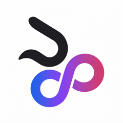
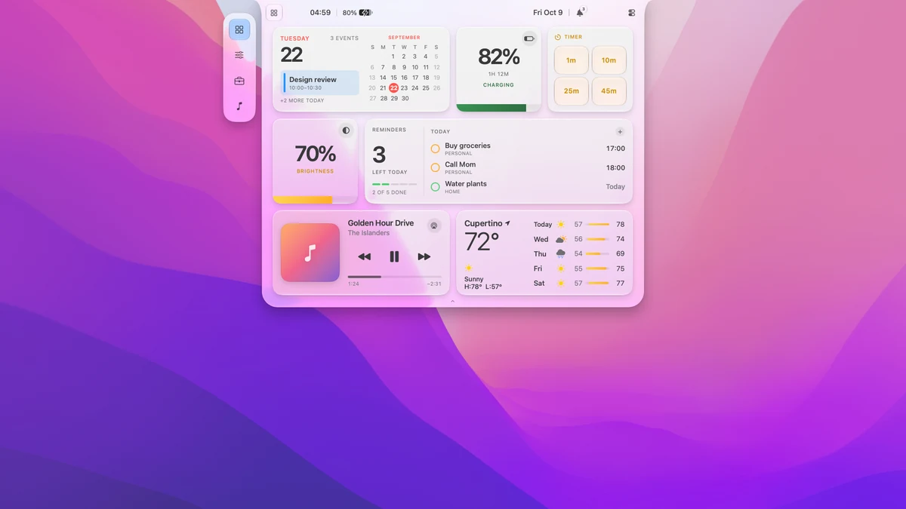
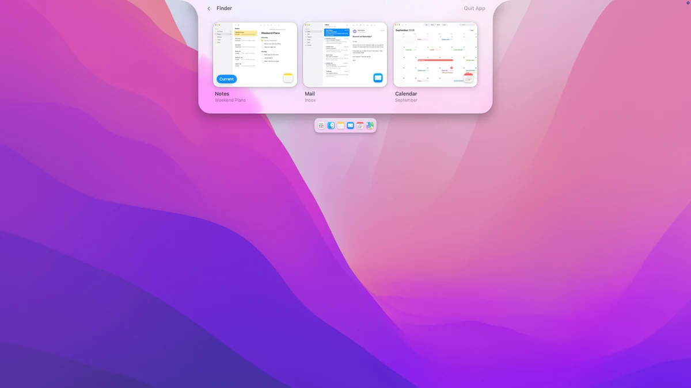

  

<h1 align="center">N8Island</h1>

  <strong>Your Mac. Within reach.</strong> 
  Messages, music, files, widgets, and everyday controls 
  in your Mac’s notch or menu bar.

  <strong>7 days free · $9.99 once · Up to two Macs · macOS 26+</strong>

  <a href="https://n8island.com/download">Download</a> ·
  <a href="https://n8island.com/preview">Interactive preview</a> ·
  <a href="https://www.youtube.com/watch?v=OsaukWqTa-k">Watch the film</a> ·
  <a href="https://n8island.com/gallery">Gallery</a> ·
  <a href="https://github.com/n8guest/n8island-app/issues">Support</a>

  <picture>
    <source media="(prefers-color-scheme: dark)" srcset="images/home-dark.webp">
    
  </picture>

Hover over the Island to open it, or click to pin it. Arrange widgets into
pages and choose what appears on each display. It works on Macs with or without
a notch. [Try the interactive preview](https://n8island.com/preview) in your
browser before downloading.

## Download and install

Requires **macOS 26 or later** on an Apple silicon or Intel Mac.

1. [Download N8Island](https://updates.n8island.com/download) and open the `.dmg` file.
2. Drag **N8Island** into **Applications**, then open it from there.
3. Choose **Start 7-Day Trial**. Enable the integrations you want to use; the app
   explains the macOS permissions they need.

The download is signed and notarized. Every feature is free for seven days,
with no card or account needed.

## Features

- **Widgets and pages.** Arrange resizable widgets for weather, calendar,
  reminders, timers, battery, system usage, Now Playing, clipboard, and more.
- **Apps and windows.** Switch recent apps, browse open windows, search a
  Launchpad-style app grid, or use a recent-apps dock at a display edge.
- **Files.** Pin files and folders, browse and search, preview with Quick Look,
  and drag files between the Island and other apps.
- **Messages, notifications, and calls.** Send quick replies in Messages, review
  notification history, and control Phone and FaceTime calls. Hover over a
  notification to read a longer message.
- **Music.** See what’s playing, pause or skip tracks, scrub through a song, and
  choose your audio output.
- **Passwords.** Import a copy of your logins from Apple Passwords, unlock with
  Touch ID or your Mac’s password, and copy passwords and verification codes.
- **Actions.** Create tiles for apps, websites, Apple Shortcuts, and system
  controls such as timers, mute, Low Power Mode, and locking your Mac.
- **Xcode.** Build, run, test, and stop projects from the Island and follow their
  progress.
- **Lock screen.** Show music, weather, and battery widgets. Optional,
  experimental Face Unlock uses your camera and a password stored in Keychain;
  it is not Apple Face ID.

  <picture>
    <source media="(prefers-color-scheme: dark)" srcset="images/windows-dark.webp">
    
  </picture>

See more screenshots in the [gallery](https://n8island.com/gallery).

## Trial and license

The **seven-day trial** starts when you choose **Start 7-Day Trial** and keeps
counting while the app is closed. Every feature is included. No card or account
is needed.

A **$9.99 USD one-time license**, plus applicable tax, activates **up to two Macs
at the same time**. No subscription. Existing license keys include the second Mac.

The License page shows your usage, such as **1 of 2 Macs active**. To replace a
Mac when both slots are in use, choose **Deactivate This Mac** on the Mac you’re
replacing, then activate the new one with the same key. Your other Mac stays
activated. An activated license works for up to 30 days offline.

[Buy a license](https://license.n8island.com/purchase) ·
[Recover your key](https://license.n8island.com/recover) ·
[Refund policy](https://n8island.com/refunds)

## Updates

The [download page](https://n8island.com/download) always has the latest version
and full release history. You can also follow
[releases on GitHub](https://github.com/n8guest/n8island-app/releases).

N8Island checks for updates automatically and asks before installing. To check
manually, open **Settings › ⋯ › Check for Updates**.

## Privacy and permissions

No account is required. Your settings, clipboard and notification history,
imported passwords, and Face Unlock data stay on your Mac.

Licensing and update checks use N8Island’s services. Features such as weather,
artwork, and icon lookups contact Apple or the relevant websites. You choose
which integrations and macOS permissions to enable. See the
[privacy policy](https://n8island.com/privacy) for details.

## Support

[Open an issue](https://github.com/n8guest/n8island-app/issues) for bugs or feature
requests. For bugs, include
your macOS version, N8Island version, and steps to reproduce the problem. To
find the app version, select N8Island in Applications and choose
**File › Get Info**.

## About this repository

This repository contains the public documentation, release notes, and issue tracker.
N8Island is proprietary software; its source code is not public.

[Website](https://n8island.com) · [Terms](https://n8island.com/terms) ·
[Privacy](https://n8island.com/privacy)

© 2026 Nathan Guest. All rights reserved.
